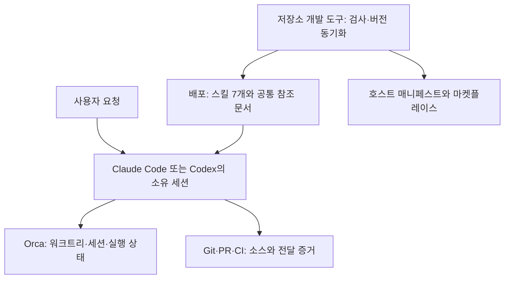

# 제품과 개발 도구의 구조

규칙의 정본은 설치에 포함되는 [세션 소유권 구조](../plugins/oh-my-teams/references/architecture.md)에 있다. 이 문서는 저장소의 구조와 변경 영향을 설명하며 공통 규칙을 중복해서 관리하지 않는다.

개발 도구의 포트·어댑터 구조와 의존성 규칙은 [개발 도구와 공통 예제](DEVELOPMENT.md#의존성-방향과-포트)에 정리했다.

## 실행 경계

호스트가 스킬을 읽고 도구를 호출한다. OMT 안에 별도 작업 스케줄러나 세션 등록부는 없다. `scripts/`, `tests/`, `examples/`, `docs/`는 저장소 개발에 사용하며 플러그인 내부의 실행 의존성이 아니다. 배포 문서는 저장소의 `docs/` 링크에 의존해서는 안 된다.

## 개발 도구의 처리 흐름

| 진입점 | 처리 순서 | 실패 처리 |
|---|---|---|
| `check-skills.mjs` | 루트 정규화 → 매니페스트 → 스킬 집합·메타데이터 → 전체 설치 문서의 폐기 명령·링크·앵커 | 발견한 문제를 모으되 파일 시스템 예외가 발생하면 그 시점에서 검사를 중단하고 실패 보고서를 반환한다. 구현 오류는 전파한다. |
| `metadata.mjs` | 정본 버전 읽기 → 대상 전체 파싱·계획 → 스냅샷 비교 → 임시 쓰기·교체 | 검사 모드는 쓰지 않는다. 쓰기 실패 시 이 실행이 교체한 파일을 역순으로 복구하며, 관측한 외부 변경은 보존하고 복구 충돌도 함께 전달한다. |
| `check-source.mjs` | 활성 `.mjs` 수집 → JavaScript 구문·스코프 분석 → JSDoc·줄 길이 → 의존성·순환 검사 | 문법 오류는 진단으로 모은다. 파일 접근 오류는 플러그인 검사처럼 보고서로 바꾸지 않고 전파한다. |
| `documents.mjs` | 제한된 YAML 파싱 → JSON Schema → 의미 규칙·선택적 요청 대응 검사 → JSON 또는 HTML | 오류 시 출력 생성을 중단하고 종료 코드 1을 반환한다. 기존 출력 파일은 덮어쓰지 않는다. |
| `check-docs.mjs` | README·`docs/`·`evals/` 수집 → 저장소 경계 → 링크·앵커 | 경계를 벗어난 링크와 파일 시스템 오류는 실패 보고서로 반환하며 구현 오류는 전파한다. |

도구의 오류 전달 방식은 완전히 같지 않다. 호출자는 `status`만 검사하면 모든 실패를 처리할 수 있다고 가정해서는 안 된다. 동기화는 예외를 던지며 플러그인 검사도 구현 오류는 예외로 전달한다.

현재 경계에서 확인한 검사 공백과 개선 순서는 [프로젝트 분석](PROJECT_ANALYSIS.md)에 정리했다.
