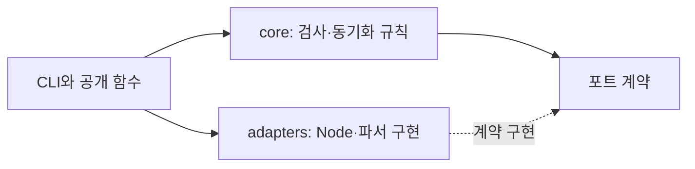

# 개발 도구와 공통 예제

플러그인은 스킬, 참조 문서와 내부 문서의 JSON Schema·YAML 예제를 배포한다. 아래 모듈과 예제는 저장소 개발 도구이며, 설치 패키지에 실행기를 추가하지 않는다. 새 검사를 작성할 때는 기존 책임에 맞는 모듈을 사용한다.

| 파일 | 책임 |
|---|---|
| `scripts/check-skills.mjs`, `metadata.mjs`, `check-source.mjs` | 기본 경로·시간·어댑터를 조합하고 기존 공개 함수와 CLI를 제공한다. |
| `scripts/core/plugin-validation.mjs` | 검사 순서와 스킬 집합·메타데이터 규칙, 최종 보고서를 담당한다. |
| `scripts/core/plugin-paths.mjs`, `plugin-documents.mjs` | 경로의 경계와 탐색 정책, 매니페스트 진입점, 로컬 링크를 검사한다. |
| `scripts/core/version-sync.mjs` | 모든 입력을 읽고 검증한 뒤 버전 변경 계획을 만들고 적용한다. |
| `scripts/core/source-quality.mjs` | 파싱된 소스에서 JSDoc, 줄 길이, 의존성 방향과 순환 참조를 검사한다. |
| `scripts/core/ports.mjs` | 파일 접근·문서 파서·JavaScript 분석·버전 문법·보고서의 구조적 계약을 정의한다. |
| `scripts/adapters/node-files.mjs` | 실제 파일 접근, 읽기 오류의 경로 보존, 일괄 쓰기와 실패 복구를 구현한다. |
| `scripts/adapters/document-syntax.mjs`, `javascript-syntax.mjs` | YAML·Markdown 파싱과 JavaScript 구문·스코프 분석을 구현한다. |
| `scripts/adapters/version-syntax.mjs` | 정본 버전이 빌드 메타데이터 없는 엄격한 SemVer인지 확인한다. |
| `scripts/documents.mjs` | YAML 문서 변환의 공개 함수와 CLI를 제공한다. |
| `scripts/core/omt-documents.mjs` | 보고서의 의미 규칙, 요청·결과의 대응과 HTML 표시를 담당한다. |
| `scripts/adapters/omt-documents.mjs` | 제한된 YAML 파싱, JSON Schema 검사와 CLI 입출력을 구현한다. |
| `tests/helpers/plugin-fixture.mjs` | 정규화된 임시 경로, 설치 구조 복사, 매니페스트 수정을 제공한다. |

`validatePlugin(pluginRoot)`는 저장소와 독립적인 설치 경로를 받아 `{ status, skills, findings }`를 반환한다. 검사 규칙은 발견한 문제를 `findings`에 추가한다. 파일 시스템 오류는 최상위에서 경로·오류 코드와 함께 보고한다. 파일 포트는 읽기 오류의 `code`, `syscall`, `path`를 보존한다. 문서 파서는 잘못된 입력에 `SyntaxError`를 사용하고, `TypeError` 같은 예상하지 못한 구현 오류는 호출자에게 전달한다. JSON 문법 오류와 패키지 계약 위반은 해당 매니페스트의 검사 실패로 보고한다.

## 의존성 방향과 포트



`core`는 `node:path`와 다른 core 모듈에만 의존한다. 파일·프로세스 접근, 구체 어댑터와 외부 라이브러리 import, 암묵적인 시간 조회를 넣지 않는다. 어댑터는 core와 같은 계층의 어댑터에 의존할 수 있으며, CLI나 테스트를 가져오지 않는다. 공개 함수가 기본 어댑터와 시간을 제공하므로 기존 호출 방식은 유지된다. 테스트는 포트를 교체하거나 실제 어댑터를 사용하는 통합 검사 중 필요한 방식을 선택한다.

`FilesPort`의 `realPath`, `kind`, `entries`, `readText`는 검사에 필요한 읽기 기능이며, `writeBatch`는 동기화가 사용하는 쓰기 기능이다. `DocumentSyntaxPort`는 메타데이터, 링크와 앵커를 파싱한다. `VersionSyntaxPort.isReleaseVersion()`은 정본 버전의 허용 여부를 판단한다. 포트는 JSDoc으로 정의하며 클래스 상속이나 별도 서비스 컨테이너를 요구하지 않는다.

JavaScript 분석 결과에는 ESTree 형식의 `ast`, 주석 위치를 담은 `comments`, 식별자의 바인딩을 담은 `bindings`, 해석되지 않은 전역 참조를 담은 `globals`가 필요하다. 어댑터는 Acorn과 `eslint-scope`로 이 정보를 만든다. `bindings`는 식별자의 시작 위치를 키로 사용하며, `{ node, path }` 객체 배열을 값으로 사용한다. `node`는 대상 노드의 `시작 위치:노드 타입` 키이고 `path`는 구조 분해로 선택한 속성·인덱스의 문자열 배열이다. core는 이 정보를 따라 공개 함수의 별칭을 추적하고 전역 `Date`, `process`, `globalThis` 참조를 진단한다. `validateSources(root, { parse })`에 대체 파서를 전달할 때에도 네 필드를 모두 반환해야 한다. 구문 트리와 주석만 반환하는 이전 대체 파서는 새 계약에 맞춰야 한다.

YAML의 미정의 별칭, 전방 별칭 참조와 과도한 별칭 확장은 `toJS()` 변환 단계에서도 실패할 수 있다. 문서 어댑터는 알려진 입력 오류만 `SyntaxError`로 변환한다. 정상적인 앵커·별칭은 유지하고 예상하지 못한 `TypeError`나 `ReferenceError`는 전파한다. 해당 분류는 설치된 YAML 버전의 오류 메시지에 의존하므로 의존성을 갱신할 때 [별칭 회귀 검사](../tests/document-syntax.test.mjs)를 확인한다.

## 공통 함수를 사용하는 예제

[실행 가능한 예제](../examples/plugin-validation.test.mjs)는 설치 패키지를 임시 디렉터리에 복사한 뒤 한 가지 조건만 바꾸고 결과를 확인한다. 다음 패턴으로 회귀 검사를 추가한다.

```js
import test from "node:test";
import assert from "node:assert/strict";
import { validatePlugin } from "../scripts/check-skills.mjs";
import { pluginFixture, editManifest } from "../tests/helpers/plugin-fixture.mjs";

test("bundled entry point", (t) => {
  const plugin = pluginFixture(t);
  editManifest(plugin, "claude", { skills: ["./skills/"] });
  assert.equal(validatePlugin(plugin).status, "passed");
});
```

이 상대 경로는 저장소의 `tests/`나 `examples/`에 예제를 둘 때 사용한다. `pluginFixture(t)`는 테스트가 끝나면 복사본을 자동으로 삭제한다. 반환 경로는 `realpath`로 정규화하므로 macOS의 임시 디렉터리 별칭과 Windows 디렉터리 링크에서도 같은 경로로 파일을 비교할 수 있다. 복사본 밖의 파일은 바꾸지 않는다. 잘못된 입력을 검사할 때에는 실패 상태와 구체적인 오류 내용도 함께 확인한다. 같은 예제 파일에는 `validatePlugin(plugin, { syntax })`로 파서 포트를 교체하는 사례도 있다. 파일 오류 검사는 `{ files }`를 전달하며 전역 `fs`를 바꾸지 않는다.

예제만 실행하려면 다음 명령을 사용한다. `npm test`에도 같은 파일이 포함되어 있으므로 코드가 바뀌면 예제도 함께 검증한다.

```sh
node --test examples/plugin-validation.test.mjs
```

버전 동기화는 기존 `synchronize(write)` 호출을 유지한다. 격리된 저장소와 고정된 시간을 사용하는 검사는 다음처럼 작성한다. 실제 사용 예는 [동기화 회귀 검사](../tests/metadata.test.mjs)에 있다.

```js
const options = { root: temporaryRepository, now: new Date("2026-10-15T01:02:03Z") };
const result = synchronize(false, options);
```

검사 모드는 파일을 변경하지 않는다. 쓰기 모드에서는 기본 버전과 14자리 빌드 값이 유효한 Codex 버전을 보존하며, 기본 버전이 달라졌거나 빌드 값이 잘못되었을 때만 새 값을 만든다. 테스트는 정상 값 보존, 누락·타입 오류 복구, 반복 실행 시 변경이 없어지는지를 확인한다.

동기화는 모든 JSON과 버전 대상의 형식을 먼저 검증하므로 뒤쪽 입력이 잘못되어도 앞 파일을 수정하지 않는다. Node 어댑터는 같은 디렉터리의 고유 임시 파일에 내용을 기록하고 권한을 보존한 뒤, 원본 스냅샷을 다시 확인하고 이름 변경으로 교체한다. 실패한 임시 쓰기는 원본을 잘라내지 않는다. 복구에서도 현재 내용이 이 실행이 쓴 내용인지 확인하며, 다른 변경이 발견되면 보존하고 원래 오류와 복구 충돌을 `AggregateError`로 전달한다. 주입하는 `writeText`의 경로는 최종 대상이 아닌 임시 파일이다. 정상 완료와 처리 가능한 실패 후에는 임시 파일을 제거한다.

동기화는 단일 실행자를 전제로 한다. 내용 비교와 이름 변경 사이의 경쟁, 프로세스 강제 종료와 여러 파일 전체의 원자성을 보장하지 않는다. 충돌 때문에 복구를 건너뛴 경우에는 보고된 파일을 확인하고 동기화 결과를 다시 검증해야 한다. 별도 실행 등록부나 Orca의 감독 기능은 추가하지 않는다.

동기화는 한 번에 하나의 실행자가 대상 파일을 변경한다는 전제에서 사용한다. 사전 비교 이후 외부 수정은 덮어쓸 수 있으며 복구도 외부 변경과 충돌할 수 있다. 동시에 버전을 편집하거나 여러 동기화 프로세스를 실행하지 않는다.

정본 버전은 `semver` 어댑터로 검사한다. `3.0.6`이나 `3.0.6-rc.1`은 허용하지만 `v3.0.6`, 앞뒤 공백, 잘못된 숫자 형식과 `3.0.6+build`는 거부한다. Codex 빌드 접미사를 별도로 붙이므로 정본의 빌드 메타데이터는 허용하지 않는다. Codex 접미사는 여전히 14자리 숫자인지만 검사하며 실제 달력 날짜는 검증하지 않는다. 공개 `synchronize(write, options)`는 기본 버전 어댑터를 제공하고, core 함수를 직접 호출할 때에는 `options.versions`도 전달해야 한다.

## 내부 문서의 변환과 표시

내부 통신 문서의 필드와 자료형은 설치되는 [JSON Schema](../plugins/oh-my-teams/references/documents/document.schema.json)에 정의한다. [YAML 사용 규칙](../plugins/oh-my-teams/references/documents/protocol.yaml)은 의미 검사와 사용 범위를 설명한다. 최초 전환 범위는 검토 요청, 검토 결과와 상태 보고다. 작업 시작·완료·중단 문서는 아직 전환하지 않았다. 스킬 진입점과 기존 정책 참조 문서는 호스트의 기존 Markdown 구조를 유지한다.

`parseOmtDocument(source, options)`는 코드에서 직접 사용할 JSON 호환 객체를 반환한다. `convertDocument(source, format, options)`는 같은 객체를 `json`, `html`, `check` 중 하나의 결과 문자열로 변환한다. 먼저 YAML 1.2 단일 문서를 읽고, 중복 키·별칭·태그·비문자열 키·손실이 발생하는 숫자·과도한 크기와 중첩을 거부한다. Ajv와 `ajv-formats`로 draft-07 스키마와 실제 날짜를 검사하며, 자료형을 강제로 변환하거나 누락된 값을 자동으로 채우지 않는다. 이후 core에서 독립 검토의 실행 식별자, 관측 실패, CI 대상 커밋과 전달·정리 상태의 모순을 검사한다. 구조가 맞더라도 관측 실패를 성공으로 바꾸는 보고는 변환하지 않는다.

`options.requestSource`에 원래 검토 요청 YAML을 전달하면 결과의 `in_reply_to`, 목적과 대상 식별자를 대조한다. CLI에서는 `--request request.yaml`을 사용한다. 이 옵션을 생략한 검사는 결과 문서 자체만 검증하며, 실제 요청과의 일치를 입증하지 않는다. 구조와 의미 검사는 출처의 실제 존재, 독립 실행의 진위나 사용자 권한을 대신 확인하지 않는다. 소유 세션이 Orca·Git·CI에서 근거를 확인해야 한다.

JSON과 HTML은 같은 검증 데이터의 파생 결과다. 코드는 객체를 직접 사용하고, 외부 전달이나 저장에 필요한 경우에만 JSON으로 직렬화한다. HTML에는 문서 정보, 근거와 불확실성을 모두 포함하며 모든 값을 텍스트로 이스케이프한다. 스크립트와 외부 자원, 실행 가능한 링크가 없는 단일 파일이며 모바일 표시와 인쇄 스타일을 포함한다. 출처 위치는 안전한 텍스트로 표시한다.

```sh
node scripts/documents.mjs check plugins/oh-my-teams/references/documents/review-result.example.yaml --request plugins/oh-my-teams/references/documents/review-request.example.yaml
node scripts/documents.mjs html plugins/oh-my-teams/references/documents/status-report.example.yaml /new/path/status.html
```

입력 경로 `-`는 표준 입력이며, 출력 경로를 생략하면 표준 출력으로 내보낸다. 출력 파일은 새 파일만 만들고 기존 파일은 덮어쓰지 않는다. 변환에 실패하면 종료 코드 1과 진단을 반환하고 출력 파일을 만들지 않는다. `npm run documents --`를 앞에 붙여 호출할 수도 있지만 JSON을 다른 프로그램에 연결할 때에는 npm 로그가 섞이지 않도록 `node scripts/documents.mjs`를 직접 사용한다.

설치 패키지는 양식과 스키마를 자체 포함하며 저장소 개발 명령에 링크하지 않는다. 설치된 호스트는 문서 규칙을 읽고 지원하는 도구로 객체와 HTML을 생성한다. 저장소 변환기는 개발·검증에 사용하며 설치만으로 실행된다고 가정하지 않는다. HTML 표시가 불가능한 호스트의 대체 보고 규칙은 YAML 사용 규칙을 따른다.

[문서 회귀 검사](../tests/omt-documents.test.mjs)는 격리된 플러그인 설치의 스키마와 예제, 잘못된 YAML·스키마·상태 보고, 요청 대응, HTML 텍스트 보존과 삽입 방지, 파일·표준 입력 CLI와 기존 출력 보존을 검사한다. 이 검사는 실제 호스트의 스킬 선택이나 Orca 조회를 자동 실행하지 않는다.

## 자동 품질 검사와 CI

`npm run quality`는 먼저 JavaScript 소스를 검사한 뒤 설치 패키지를 검사한다. 소스 검사는 상태 디렉터리와 `node_modules`·`.git`을 제외한 `.mjs`를 수집하고, 파싱된 구문 트리와 주석 위치로 모듈 JSDoc, 공개 함수의 인자·반환 설명, 실행문 줄 길이와 의존성을 확인한다. 허용되지 않은 계층의 모듈, 계산된 import, 누락된 로컬 import와 순환 참조도 실패로 보고한다. 새 파일도 커밋 전부터 검사한다. 이 검사는 정적 규칙이며 주석의 의미나 모든 동적 실행을 검증하는 보안 격리 장치는 아니다.

Jenkins의 Linux 단계는 OMT 전용 Colima 프로필을 사용한다. 기존 운영 전제는 `macmini` 에이전트의 실행 슬롯이 하나라는 것이지만 슬롯 수는 저장소 설정만으로 확인할 수 없다. `disableConcurrentBuilds()`만으로 서로 다른 브랜치 작업까지 직렬화된다고 가정하지 않는다. 실행 슬롯을 늘릴 때에는 프로필 공유를 막을 수단을 먼저 마련해야 한다. Linux 단계는 시작·이미지 빌드·컨테이너 실행·종료를 한 실행에서 처리하며 다른 프로젝트의 Colima 프로필을 종료하지 않는다.

두 CI 단계는 `quality`, `format:check`, `test`를 실행한다. 로컬의 `lint`와 명령 구성은 다르며 동기화 일치는 패키지 계약 테스트에서 확인한다. Jenkins 플러그인을 사용하는 단계를 추가하기 전에는 실제 서버의 지원 여부를 확인한다. 설정 파일만 보고 단계 실행 성공을 추정하지 않는다.

## 수정과 검증

새 공통 함수는 실제로 반복되는 책임이 있을 때 추가한다. 테스트에서 제품 코드의 기대값을 그대로 가져와 비교하지 않고, 입력과 관찰 가능한 결과를 확인한다. 코드 조각 전체를 문서마다 복사하지 않고 실행 가능한 예제로 연결한다. 공개 함수의 JSDoc과 기존 `validatePlugin`·`synchronize` 호출 계약을 유지한다.

```sh
npm run format
npm run sync
npm run lint
npm test
```

새 체크아웃에서는 먼저 `npm ci`를 실행한다. 버전을 바꾼 경우 `npm install`로 잠금 파일도 갱신한다. 병합 전에는 Jenkins의 Linux·macOS 결과를 확인한다. 검사 범위와 한계는 [코드와 스킬 검증](CODE_QUALITY.md)에 정리되어 있다.

후속 개선은 [프로젝트 분석과 개선 계획](PROJECT_ANALYSIS.md)의 재현 입력과 완료 기준을 출발점으로 삼는다. 문서만 수정하더라도 `docs/` 링크와 한국어 문장은 별도로 대조한다. 현재 `quality`와 Prettier는 이 디렉터리의 Markdown 품질을 검사하지 않는다.
