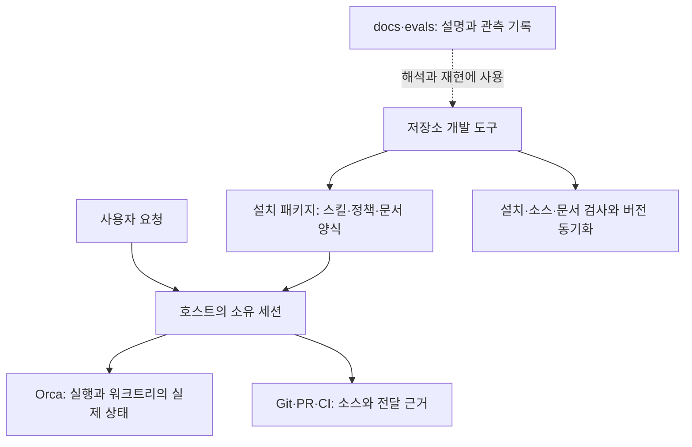

# 프로젝트 분석과 개선 계획

최초 분석 기준은 `4d423a97b01b47aea1c1c33f0311ba8ed3371e74`, 패키지 `3.2.1`이다. 설치 스킬·문서·개발 모듈·테스트·CI를 읽고 로컬 검증과 두 가지 비파괴 확인을 수행했다. 이 문서는 이어서 구현한 `3.3.0`의 요청 구성·검토 선택·완료 근거 대조와 AGENTS 검사 개선을 반영한다. 규모 표는 개선 후 파일 기준이며, 과거 관측은 당시 기준을 따로 표시한다. 실제 HEAD와 CI·호스트 결과는 작업할 때 다시 확인한다.

AI가 수정 위치와 실행할 검사를 찾을 때에는 [AI 작업 안내](AI_GUIDE.md)를 먼저 사용한다. 3.0.5에서 시작한 최초 재현과 후속 관측은 [2026-10-15 분석 기록](PROJECT_ANALYSIS_20261015.md)에 보존했다. 과거의 미해결 항목을 현재 결함으로 취급하지 않는다.

## 1. 제품의 목적과 실행 경계

OMT는 Claude Code·Codex가 Orca에서 작업할 때 따르는 스킬 패키지다. 워크트리마다 소유 세션 하나가 요청 해석, 편집, 검증과 전달을 책임진다. 전문 검토자는 읽기 전용이며, 독립적인 동시 편집이 필요할 때만 별도 Orca 워크트리를 사용한다. 실제 세션·터미널·프로세스의 상태는 Orca에, 소스와 전달 결과는 Git·PR·CI에 있다.

[설치 패키지](../plugins/oh-my-teams/)에는 Markdown 스킬·참조 문서, 호스트 매니페스트, JSON Schema와 YAML 예제가 들어 있다. 저장소의 Node 개발 도구는 설치 패키지 밖에 있다. `package.json`은 `private: true`이며 의존성은 모두 `devDependencies`다. 설치된 스킬을 읽는 데 저장소의 Node CLI가 필수라는 뜻이 아니다. [패키지 계약 테스트](../tests/package-contract.test.mjs)는 이 경계를 검사한다.



새 OMT 실행은 2.x의 조직·workflow 기록을 읽어 이어 붙이지 않는다. `.omt`, `.omc`, `.orca`는 소스 검사에서 제외되는 상태 디렉터리이며 현재 실행의 정본이 아니다. 제외되거나 Git에서 무시된다는 이유로 기존 자료를 일괄 삭제할 근거도 되지 않는다. 제품 계약은 [세션 소유권 구조](../plugins/oh-my-teams/references/architecture.md)와 [실패 판단](../plugins/oh-my-teams/references/failure-handling.md)을 따른다.

## 2. 저장소 규모와 의존성

줄 수는 UTF-8 파일을 `splitlines()`로 나누어 빈 줄과 주석을 포함해 집계했다. 테스트 수는 Node 실행 결과이며 반복·하위 테스트를 포함한다. 줄 수나 테스트 개수는 분기 커버리지와 운영 신뢰도의 측정값이 아니다.

| 영역 | 파일 수 | 줄 수 | 역할 |
|---|---:|---:|---|
| `scripts/` 전체 | 19 | 2,120 | 공개 함수·CLI, core 규칙과 어댑터를 포함한다. |
| 위 목록 중 `scripts/core/` | 9 | 1,370 | 검사·동기화·보고서 의미 규칙과 포트 계약을 정의한다. |
| 위 목록 중 `scripts/adapters/` | 5 | 489 | 파일 시스템과 외부 파서를 연결한다. |
| `tests/` | 13 | 2,747 | 테스트 파일 12개와 공통 fixture 1개다. |
| `examples/` | 1 | 51 | 공개 API의 실행 가능한 사용 예제다. |
| 설치 `SKILL.md` | 7 | 180 | 호스트가 선택하고 읽는 작업 지침이다. |

활성 `.mjs`는 합계 33개다. 가장 큰 개발 모듈은 [보고서 의미 검사·HTML 생성](../scripts/core/omt-documents.mjs)의 446줄과 [소스 품질 검사](../scripts/core/source-quality.mjs)의 348줄이다. 두 파일은 변경 영향이 집중되는 위치이지만, 파일 크기만으로 분리를 결정할 근거는 부족하다.

| 개발 의존성 | 현재 사용하는 목적 | 갱신 시 확인할 곳 |
|---|---|---|
| `acorn`, `eslint-scope` | ECMAScript 2025 구문과 식별자 바인딩·전역 참조를 분석한다. | `source-quality.test.mjs`와 대체 파서의 반환 계약을 확인한다. |
| `yaml` | 스킬 frontmatter와 제한된 통신 YAML을 각각 파싱한다. | `document-syntax.test.mjs`, `omt-documents.test.mjs`를 확인한다. 두 파서의 허용 범위는 다르다. |
| `ajv`, `ajv-formats` | draft-07 스키마와 날짜 형식을 검증한다. | 여덟 예제, 잘못된 입력과 생명주기 요청 대응 검사를 확인한다. |
| `mdast-util-from-markdown`, `mdast-util-to-string` | 실제 Markdown 링크·제목과 표시 텍스트를 읽는다. | 설치 문서와 저장소 문서의 링크·앵커 검사를 확인한다. |
| `github-slugger`, `parse5` | GitHub 제목 앵커와 HTML 앵커·표시 결과를 읽는다. | 한글·중복 제목과 HTML 텍스트 보존 검사를 확인한다. |
| `semver` | 정본 버전의 엄격한 SemVer를 검사한다. | 버전·Codex 날짜·중단 후 재실행 검사를 확인한다. |
| `prettier` | `.mjs`, `.json`, `.yaml`의 형식을 결정한다. | `format:check`와 전체 diff를 확인한다. Markdown은 대상이 아니다. |

Node 요구 버전과 정확한 의존성 버전은 [package.json](../package.json), 설치 해석 결과는 [package-lock.json](../package-lock.json)이 정본이다. 분석 문서에 별도의 버전 표를 계속 복제하지 않는다.

## 3. 설치되는 일곱 스킬

| 스킬 | 책임 | 호출·종료에서 구분할 사항 |
|---|---|---|
| [help](../plugins/oh-my-teams/skills/help/SKILL.md) | 스킬의 사용 시점을 안내한다. | 일반적인 개발 요청은 현재 세션이 직접 처리한다. |
| [kickoff](../plugins/oh-my-teams/skills/kickoff/SKILL.md) | 요청받은 여러 세션의 협업·지속 감독을 시작하거나 재개한다. | 기존 실행을 먼저 대조하며 Goal과 새 워크트리를 자동으로 늘리지 않는다. |
| [consult](../plugins/oh-my-teams/skills/consult/SKILL.md) | advisor·lawyer·auditor 목적의 읽기 전용 검토를 요청한다. | 검토자의 원문과 실행 신원을 보존하고 사용자 질문은 소유 세션을 통해 처리한다. |
| [status](../plugins/oh-my-teams/skills/status/SKILL.md) | Orca·Git·CI의 관측을 보고한다. | 관측 완전성과 작업 성공, 결과 전달과 정리는 각각 다른 상태다. |
| [close](../plugins/oh-my-teams/skills/close/SKILL.md) | 수용 기준을 검증하고 허가된 전달·회수를 수행한다. | 최신 HEAD의 검사와 필요한 독립 검토, 전달 권한과 정확한 인스턴스를 확인한다. |
| [disband](../plugins/oh-my-teams/skills/disband/SKILL.md) | 실패·취소 시 결과를 보존하고 재개 정보를 남긴다. | 종료 요청과 실제 종료를 구분하며 미전달 결과를 보존한다. |
| [fluent-korean](../plugins/oh-my-teams/skills/fluent-korean/SKILL.md) | 한국어 문서와 보고의 의미·문장 완결성을 점검한다. | 코드·주석·프로젝트 관례의 커밋 문구는 적용 범위와 구분한다. |

스킬 집합은 [plugin-validation.mjs](../scripts/core/plugin-validation.mjs)와 패키지 계약 테스트에 고정되어 있다. 새 스킬을 추가하는 변경은 파일 하나를 만드는 것으로 끝나지 않는다. 선택 설명, 공통 정책, 고정 집합과 설치 복사본의 자급성을 함께 검토해야 한다.

## 4. 개발 도구의 구조와 공개 계약

진입점이 실제 파일·파서·시각을 조합하고 core는 주입받은 기능으로 규칙을 실행한다. [ports.mjs](../scripts/core/ports.mjs)의 JSDoc이 구조적 계약을 정의한다. 별도 DI 컨테이너나 TypeScript 빌드는 없다.

| 진입점과 공개 함수 | 처리 흐름 | 결과와 오류 처리 |
|---|---|---|
| [check-skills.mjs](../scripts/check-skills.mjs)의 `validatePlugin()` | 루트 정규화 → 매니페스트 → 고정 스킬과 frontmatter → 전체 설치 Markdown의 폐기 명령·링크·앵커를 검사한다. | `{ status, skills, findings }`를 반환한다. 파일 시스템 오류와 입력 문법 오류는 진단으로 만들고 예상하지 못한 구현 오류는 전파한다. |
| [check-docs.mjs](../scripts/check-docs.mjs)의 `validateRepositoryDocs()` | `README.md`, 존재하는 `AGENTS.md`, `docs/`, `evals/`를 모아 저장소 경계로 링크·앵커를 검사한다. | `{ status, documents, findings }`를 반환한다. 설치 문서는 별도 플러그인 경계로 검사한다. |
| [check-source.mjs](../scripts/check-source.mjs)의 `validateSources()` | 활성 `.mjs`를 수집하고 JavaScript 파서 결과로 문서·길이·의존성·전역 접근과 경로 정규식을 검사한다. | `{ status, modules, findings }`를 반환한다. 구문 오류는 진단이지만 파일 접근 오류는 그대로 전파한다. |
| [metadata.mjs](../scripts/metadata.mjs)의 `synchronize()` | 입력 전체 검증 → 변경 계획 → 검사 또는 일괄 교체를 수행한다. | `{ changed, mismatches }`를 반환한다. 잘못된 입력, 스냅샷 충돌과 쓰기 오류는 예외다. |
| [documents.mjs](../scripts/documents.mjs)의 `parseOmtDocument()`·`convertDocument()` | 제한된 YAML → JSON Schema → 의미 검사 → 선택적 요청 대응 → 객체·JSON·HTML·검사 영수증을 생성한다. | API는 잘못된 입력에 예외를 던진다. CLI는 진단과 종료 코드 1을 반환하며 기존 출력 파일을 보존한다. |

모든 도구의 오류를 `status === failed` 하나로 처리할 수는 없다. CLI의 `try/catch` 범위와 API 예외 계약을 함께 읽어야 한다. 상세 호출 예제는 [개발 안내](DEVELOPMENT.md)에 있다.

의존성 검사에서 core는 다른 core와 `node:path`에, 어댑터는 core·어댑터에, 진입점은 core·어댑터에 의존할 수 있다. 진입점에는 `node:url`도 허용된다. Node I/O·외부 파서·프로세스 접근은 어댑터에 둔다. core에서 `Date`, `process`, `globalThis`의 전역 참조는 거부하며 주입한 동명 인자는 전역으로 취급하지 않는다. 계산된 import와 순환 참조도 진단한다. 이 규칙은 정적 분석 범위이며 실행 격리나 모든 JavaScript 동작의 증명이 아니다.

## 5. 통신 문서와 요청 대응

필드의 정본은 [JSON Schema](../plugins/oh-my-teams/references/documents/document.schema.json), 사용 규칙은 [protocol.yaml](../plugins/oh-my-teams/references/documents/protocol.yaml)이다. 호스트 도구 인자 형식은 유지하고, OMT 메시지 본문을 YAML로 교환한다. 코드에서는 검증한 JSON 호환 객체를 처리하고 HTML·직렬화 JSON은 같은 객체에서 파생한다.

| 문서 종류 | 주요 검사 | 대응 문서가 필요한 조건 |
|---|---|---|
| `review_request` | 질문·사실·선택지·제약을 구분한다. auditor는 대상 커밋·구현 세션·수용 기준이 필요하다. | 검토 결과와 함께 요청을 보존한다. |
| `review_result` | 결론과 지적·불확실성의 모순, 독립 검토자의 실행 ID를 검사한다. | `--request` 또는 `requestSource`로 요청 ID·목적·대상을 대조한다. |
| `status_report` | 관측과 실행, 현재 Git HEAD와 CI 성공 커밋, 전달과 정리를 구분한다. | 보고서 자체를 검사하며 실제 관측은 외부 도구에서 확보한다. |
| `task_request` | 고정 커밋, 중복 없는 수용 기준·필수 검사, 전달 대상과 병합 허가 기록을 검사한다. | 완료·중단 보고의 원래 요청으로 보존한다. |
| `completion_report` | 기준별 근거, 필수 검사와 CI, 완료 선언과 남은 일의 모순을 검사한다. | `--task` 또는 `taskSource`로 기준·필수 검사·요청한 전달·필수 정리를 대조한다. `verification`이 있으면 최종 SHA의 검사·필수 CI·독립 검토·전달 관측 기록도 요구한다. 시작 커밋과 최종 커밋은 달라질 수 있다. |
| `interruption_report` | 종료 조치의 허가 기록과 실제 종료 상태, 불명확한 생존의 불확실성을 검사한다. | `--task` 또는 `taskSource`로 원래 작업 ID·워크트리와 연결한다. |

3.3.0의 [작업 흐름](../plugins/oh-my-teams/references/task-workflow.md)은 사용자 요청에서 작업 기준을 구성하고 직접 수행·필요한 검토·허가된 병렬 편집을 선택한다. [검증 조건 core](../scripts/core/task-verification.mjs)는 통과한 검사와 검토·전달의 소스 SHA, 요청한 CI 이름·대상 브랜치, 전달 방식·대상을 대조한다. 새 검증 조건·검토 근거·전달 관측 기록은 선택적 확장이며 이전 여섯 예제도 유지한다. 새 작업은 검증 조건을 포함한 두 예제를 사용한다. 실제 원문과 외부 상태는 소유 세션이 확인한다.

YAML 어댑터는 단일 YAML 1.2, 문자열 매핑 키, 유한한 숫자와 안전한 정수만 받는다. 중복 키·앵커·별칭·병합 키·명시적 태그를 거부하며 백만 UTF-16 코드 단위와 중첩 40단계의 제한을 둔다. 스킬 frontmatter 파서는 정상 앵커·별칭을 허용하므로 이 계약을 혼동하지 않는다.

`requestSource`와 `taskSource`는 동시에 지정할 수 없다. 옵션을 생략하면 문서 자체만 검사한다. 예제의 가상 식별자가 검사를 통과하더라도 실제 관측 기록이 되는 것은 아니다. HTML은 모든 문서 값을 텍스트로 이스케이프하고 스크립트·외부 자원·실행 가능한 링크를 생성하지 않는다. 기존 파일을 덮어쓰지 않는 규칙은 CLI의 출력 쓰기에도 적용된다.

## 6. 버전 동기화와 복구

정본은 `package.json.version`이다. 동기화 대상은 루트 Claude marketplace의 `metadata.version`, Claude 플러그인의 `version`, Codex 플러그인의 `version` 세 곳이다. Codex의 값에는 `+codex.<14자리 UTC 날짜>`를 붙이며 기본 버전과 날짜가 유효하면 기존 값을 보존한다. 반복 실행이 매번 새 빌드 날짜를 만드는 구조가 아니다. `.agents/plugins/marketplace.json`은 설치 카탈로그이며 현재 버전 동기화 대상이 아니다.

버전을 바꿀 때에는 `npm install`로 잠금 파일을 갱신하고 `npm run sync`로 매니페스트를 만든다. `sync` 자체가 잠금 파일을 갱신하지는 않는다. 3.3.0은 기존 문서를 읽는 계약을 유지하면서 선택적인 검증 조건과 근거 필드를 추가한다. 잠금 파일의 전이 의존성 `fast-uri`도 허용된 범위의 수정판으로 갱신했다.

[Node 파일 어댑터](../scripts/adapters/node-files.mjs)는 같은 디렉터리에 임시 파일을 만들고 권한을 보존한 뒤 데이터를 반영하고 원본을 다시 비교해 교체한다. 앞서 교체한 파일은 이 실행의 결과와 같을 때만 역순 복구하며, 외부 변경과 복구 충돌은 보존한다. `AggregateError`는 원래 실패와 불완전 복구를 함께 전달한다.

단일 실행자와 재실행에 의한 수렴이 현재 계약이다. 다중 파일의 원자적 가시성, 비교·이름 변경 사이의 경쟁 해소, 전원 장애 때의 디렉터리 내구성은 보장하지 않는다. [복구 안내](METADATA_RECOVERY.md)의 절차와 기존 JSON 읽기 계약을 먼저 확인해야 하며, 새 트랜잭션 저장소 도입은 별도 요구와 설계 결정이 필요하다.

## 7. 테스트·CI와 증거의 범위

로컬 `verify`는 `lint` 뒤 `test`를 실행한다. `lint`는 소스·플러그인·저장소 문서 품질 검사, 포맷 검사, 버전 동기화 검사를 순서대로 실행한다. 테스트는 Node 내장 실행기를 사용하고 `tests/*.test.mjs`, `examples/*.test.mjs`를 포함한다. 기본 명령은 실제 에이전트나 Orca의 생명주기를 실행하지 않는다.

[Jenkinsfile](../Jenkinsfile)은 Linux와 macOS의 Node 22.23.2 검사를 순서대로 정의한다. Linux는 macmini의 OMT 전용 Colima에서 컨테이너를 실행한다. 체크아웃을 tar로 전달하여 호스트의 심볼릭 링크 마운트에 의존하지 않으며, macOS 확장 속성과 AppleDouble 메타데이터를 제외한다. macOS checkout은 빌드 프로세스의 Git 환경 변수로 줄바꿈을 제어한다. 두 단계 모두 의존성을 복원하고 `verify`를 실행한다. 이 파이프라인에는 제품 서비스 배포 단계가 없다.

Colima 프로필은 브랜치 사이에 공유된다. `disableConcurrentBuilds()`만으로 다른 브랜치까지 직렬화된다고 가정할 수 없다. 실제 실행 슬롯과 에이전트 상태는 서버 조회가 필요하며 저장소 설정만으로 확인할 수 없다. 이번 분석에서 CI 서버 설정은 변경하지 않았다.

| 증거 | 이번에 확인한 내용 | 해석의 한계 |
|---|---|---|
| 변경 전 로컬 검증 | macOS·Node 26.7.0에서 `npm run verify`가 성공했고 테스트 209개가 통과했다. 소스 31개·스킬 7개·저장소 문서 16개에서 진단이 없었다. | 이 문서 추가 전 기준 코드의 관측이다. 다른 OS·Node 버전과 새 문서의 최종 검사는 별도로 확인한다. |
| 문서 정리 후 로컬 검증 | `format`, `sync`, `lint`, `test`와 `git diff --check`가 통과했다. 소스 31개·스킬 7개·저장소 문서 18개에서 진단이 없었고 테스트 209개가 통과했다. AGENTS의 링크·앵커는 공통 검사 함수로 별도 확인했으며 과거 분석의 본문 보존도 대조했다. | 저장소 문서만 변경한 결과다. 새로운 CI·실제 호스트 검증을 의미하지 않는다. |
| 3.3.0 개선 후 로컬 검증 | `format`, `sync`, `lint`, `test`와 `git diff --check`가 통과했다. 소스 33개·스킬 7개·저장소 문서 20개에서 진단이 없었고 테스트 240개가 통과했다. 수정한 네 스킬의 전용 구조 검사도 통과했고 의존성 감사 결과는 알려진 취약점 0건이었다. | 구조·계약 검사 결과이며 실제 호스트의 자동 선택·실행 행동을 증명하지 않는다. CI는 최종 커밋의 결과를 따로 확인한다. |
| 3.2.1의 읽기 전용 확인 | 예제 복사본의 전달 위치를 바꾸어도 요청 대응 검사에 통과했고, 저장소 문서 검사에서 루트 `AGENTS.md`를 읽지 않는 것을 확인했다. | 아래 항목은 개선 전 검사의 한계를 재현한 결과이며 제품 장애나 권한 위반이 발생했다는 뜻이 아니다. |
| 저장된 호스트 평가 | [판단 평가](../evals/README.md)와 [실제 연동 기록](../evals/LIVE_INTEGRATION.md)에 당시 환경·정책 해시·차이가 남아 있다. | 2026-10-15의 특정 버전·환경 결과다. 현재 3.3.0과 모든 호스트의 성공으로 일반화하지 않는다. |
| 후속 호스트 작업 | [todo 목록](todo/README.md)에 macOS·Linux 실제 호스트, 실제 전송 단절과 전원 장애 실험이 분리돼 있다. | 저장소에 완료 근거가 연결되지 않은 항목이다. 이번 분석에서 실행하지 않았다. |

새 검증 조건의 계약은 [회귀 검사](../tests/task-verification.test.mjs)로 확인한다. 실제 호스트의 Goal 재개·세션 연결 행동을 확인한 결과는 아니며, 병합할 때에는 최종 커밋의 Jenkins Linux·macOS 검사를 확인해야 한다. 새 호스트 평가와 개선 효과 지표는 [작업 흐름 평가](../evals/TASK_WORKFLOW.md)에 분리했다.

## 8. 현재의 한계와 개선 우선순위

다음 우선순위는 현재 코드·기록을 읽고 판단한 제안이다. 구현이나 운영 실험의 실행 지시가 아니며, 과거에 해결된 입력 검증을 다시 구현할 목록도 아니다.

| 항목 | 관측과 근거 | 영향과 다음 작업의 완료 기준 |
|---|---|---|
| 우선: 실제 호스트 검증 | 3.2.1의 Goal 재개·앱 연결·검토자의 질문 전달 지침은 추가됐으나, 기존 평가 기록은 해당 행동을 전부 재현하지 않는다. | [기존 인수 문서](todo/README.md)에서 실제 환경·설치 해시·관측 ID를 확보하고 사례별 결과를 남긴다. 실행할 수 없으면 미검증 상태를 유지한다. |
| 우선: 외부 증거의 실제 관측 | 3.3.0은 요청의 검증 조건과 기록된 SHA·방식·대상을 대조한다. 그러나 임의 URL·근거 문자열의 실재와 진위를 네트워크에서 조회하지는 않는다. | 소유 세션이 Git·PR·CI와 검토 원문에서 실제 결과를 확인한다. 외부 서비스별 자동 조회는 구체적인 요구와 권한·식별자 계약이 필요하다. |
| 우선: 문서 안내의 최신성 | 과거 분석과 이슈 분류·평가는 각각 다른 기준 커밋을 가진다. 새 독자가 이전 공백을 현재 결함으로 읽을 수 있다. | 이번 정리처럼 현재 안내와 이력을 연결한다. 공개 계약·검사 범위가 바뀌면 안내의 수정 경로도 함께 갱신한다. |
| 반영: AGENTS 링크 검사 | 3.3.0은 존재하는 루트 `AGENTS.md`의 링크·앵커·경계를 자동 검사한다. | [회귀 검사](../tests/repository-documents.test.mjs)에서 정상·누락 링크·앵커·경계와 선택적 파일 계약을 확인한다. 문장의 의미 검사는 별도다. |
| 필요 시: 진단 계약 정리 | 플러그인·문서·소스 검사와 동기화의 반환값·예외 처리가 다르다. 현재 `findings`는 문자열 배열이다. | 도구를 외부에서 조합해야 할 때에만 진단 코드나 공통 오류 계약을 검토한다. 기존 API·CLI·예제와의 호환성을 명시한다. |
| 필요 시: 복구 보장 확대 | 스냅샷 비교·복구는 있지만 다중 실행자나 전원 장애를 격리하지 않는다. | 실제 동시 실행·원자적 읽기 요구가 생기면 [복구 계약](METADATA_RECOVERY.md)과 격리 실험부터 설계한다. 기존 보장을 과장하거나 무조건 잠금 계층을 추가하지 않는다. |
| 필요 시: 소스 분석 분리 | `source-quality.mjs`는 JSDoc·공개 함수 바인딩·의존성·경로 규칙을 함께 담당한다. | 별도 규칙 변경이 반복될 때 기존 입력·진단을 보존하는 분리를 검토한다. 코드 줄 수만 줄이기 위한 재구성은 우선순위가 낮다. |

현재 검사는 외부 URL 응답, 근거의 실제 존재, 실행 신원의 진위, 사용자 허가의 진위와 누락된 필수 CI의 자동 발견을 보장하지 않는다. 이러한 항목을 보고서 검증 성공으로 대신 승인해서는 안 된다. 세부 범위는 [검사 범위 표](CODE_QUALITY.md#검사-범위와-한계)를 따른다.

### 외부 비교: Ruflo에서 차용한 점검 절차

2026-11-11에 기준 커밋 `0a17f23`(3.3.0)에서 Ruflo(이전 이름 claude-flow, `ruvnet/ruflo`의 `main`)의 공개 문서와 설정을 웹으로 읽고 비교했다. 저장소를 실행하거나 설치하지 않았으므로 아래 판단은 문서·설정 관측과 공개된 감사·이슈를 근거로 한다. ADR 원문, 세션 저장 필드와 일부 검증 명령의 본문은 확인하지 못했다.

| 구분 | 항목 | 판단 |
|---|---|---|
| 차용 | `doctor`의 고정 점검 ID, `pass`·`warn`·`fail` 판정, 진단과 수리의 분리 | [환경 진단](../plugins/oh-my-teams/references/diagnostics.md)에 Orca·Git·CI 항목과 `unknown` 판정을 더해 옮겼다. |
| 차용 | 작은 팀, 겹치지 않는 역할, 짧은 주기와 검증 게이트로 목표 이탈을 막는 방식 | 주기 점검 대신 위임·통합·재개·범위 변경·완료 직전의 [목표 재대조](../plugins/oh-my-teams/references/task-workflow.md#목표를-다시-대조한다)로 옮겼다. |
| 차용 | reviewer 에이전트의 심각도 분류와 검토 크기 제한, 품질 점검 문서의 정직성 항목 | [consult](../plugins/oh-my-teams/skills/consult/SKILL.md)에 기존 `severity` 값의 기준, 검토 분할과 auditor 점검 항목으로 옮겼다. |
| 차용 | 공유 매니페스트와 잠금 파일은 통합 소유자만 편집하고, 작업 배정은 권한을 주지 않는다는 규칙 | [kickoff](../plugins/oh-my-teams/skills/kickoff/SKILL.md)의 자식 배정 단계에 추가했다. |
| 이미 있음 | 한 워크트리에 작성자 하나, 전달 대상을 실제로 조회한 뒤 완료 보고 | 기존 소유권 구조와 완료 근거 대조가 같은 규칙을 이미 담고 있어 추가하지 않았다. |
| 차용하지 않음 | truth score와 자동 롤백, witness 서명, 훅 자동 실행과 프롬프트마다의 라우팅 주입, 학습 메모리 DB, swarm·합의 | 공개 문서가 구현되지 않았다고 밝히거나 감사에서 스텁으로 보고된 기능이 있으며, 실행 정본을 Orca에 두는 OMT 경계와 충돌한다. |
| 차용하지 않음 | 모든 작업을 한 메시지로 처리하는 규칙, 작업 목록 최소 개수, 광범위한 사전 권한 허용, 자동 공동 작성자 표기 | 편집 전 확인과 사용자 허가의 경계를 약하게 만든다. |
| 차용하지 않음 | 모델 계층 라우팅 | 사용자 결정에 따라 호스트의 모델 선택을 유지한다. |

## 9. 확인한 한계를 재현하는 방법

다음 입력은 예제의 메모리 복사본만 바꾸고 결과를 출력한다. 실제 전달이나 파일 쓰기를 실행하지 않는다. 저장소 루트에서 `npm ci`로 의존성을 준비한 뒤 실행할 수 있다.

```sh
node --input-type=module <<'JS'
import fs from "node:fs";
import { stringify } from "yaml";
import { parseOmtDocument } from "./scripts/documents.mjs";
const directory = "./plugins/oh-my-teams/references/documents/";
const request = fs.readFileSync(directory + "task-request.example.yaml", "utf8");
const source = fs.readFileSync(directory + "completion-report.example.yaml", "utf8");
const response = parseOmtDocument(source);
response.payload.delivery.reference = "https://example.invalid/omt-analysis-probe";
const result = parseOmtDocument(stringify(response), { taskSource: request });
console.log(result.payload.outcome, result.payload.delivery.reference);
JS
```

이전 양식에서는 `completed https://example.invalid/omt-analysis-probe`를 출력한다. 실제 전달의 증거가 아니며 이 한계 자체를 정상 동작으로 고정하는 테스트는 추가하지 않았다. 새 `verified-task`·`verified-completion` 예제는 전달 관측 기록을 요구하고 요청의 방식·대상과 대조한다. 그래도 기록된 관측과 URL의 실재는 소유 세션이 확인해야 한다. AGENTS 검사 누락은 3.3.0의 수집 대상 확장과 회귀 검사로 보완했다.

## 10. 이 분석을 갱신하는 기준

새 분석은 기준 SHA·날짜·패키지 버전과 실제 수행한 검사를 먼저 기록한다. 변경한 경계와 관측 가능한 결과를 기준으로 설명하고, 저장된 평가·이슈 분류의 원래 환경과 해시는 덮어쓰지 않는다. 해결된 문제는 근거를 연결해 상태를 바꾸고, 새로운 위험은 코드 관측·재현·추론 중 어느 근거인지 구분한다.

제품 정책은 설치 패키지에, 개발 API는 [DEVELOPMENT.md](DEVELOPMENT.md)에, 검사 한계는 [CODE_QUALITY.md](CODE_QUALITY.md)에 둔다. AI가 다음 작업에서 읽을 위치는 [AI_GUIDE.md](AI_GUIDE.md)에 연결한다. 같은 운영 정책과 긴 코드 예제를 여러 문서에서 별도 정본으로 관리하지 않는다.
